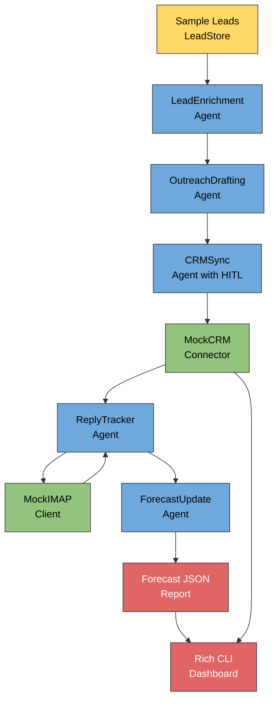

# Agentic Sales Ops Assistant

A fully agentic Python pipeline that automates the entire B2B sales development workflow: it enriches raw leads with company and LinkedIn data, drafts hyper-personalized outreach emails via a mocked LLM, syncs contacts and deals into a HubSpot-style CRM with human-in-the-loop confirmation gates, classifies email replies from a simulated inbox, and produces a weighted pipeline forecast report — all wired together by a configurable Orchestrator and displayed in a live Rich CLI dashboard. This project demonstrates how to connect AI agents directly to revenue operations, not just toy demos.

---

## Features

- **LeadEnrichmentAgent** — Calls stubbed Clearbit-style and LinkedIn-style APIs to populate each lead with industry, company size, annual revenue, HQ location, tech stack, LinkedIn URL, headline, and connection count.
- **OutreachDraftingAgent** — Selects an industry-specific email template, interpolates lead context, and simulates an LLM call (`mock-llm-v1`) to produce a personalized subject line and body. Raises if a lead has not been enriched first.
- **MockCRMConnector** — HubSpot-style in-memory CRM with `CRMContact` and `CRMDeal` records, upsert-by-email (contacts) and upsert-by-contact-id (deals), and `DealStage` enumeration with per-stage probability weights.
- **CRMSyncAgent** — Syncs enriched leads and their outreach drafts into the CRM. Every write (contact upsert and deal upsert) is gated behind a human-in-the-loop (HITL) confirmation prompt, skippable via `auto_confirm=True`.
- **ReplyTrackerAgent** — Polls a `MockIMAPClient` that generates reproducible synthetic replies (INTERESTED / NOT_INTERESTED / no reply) using a seeded RNG. Classifies bodies via keyword matching, updates lead status in both the local store and the CRM, and advances or closes deal stages accordingly.
- **ForecastUpdateAgent** — Reads all CRM deals, applies `DEAL_STAGE_PROBABILITIES` weights, and produces a `ForecastReport` with total pipeline, weighted pipeline, expected revenue, closed-lost value, per-stage breakdowns, and per-deal rows. Writes JSON to disk with a HITL overwrite gate.
- **Orchestrator** — `OrchestratorConfig`-driven run-loop that sequences all five agents, supports multiple loop iterations, structured logging throughout, and returns a `PipelineRunResult` per loop.
- **Rich CLI Dashboard** — Six panels rendered with `rich`: lead status table, outreach draft previews, CRM sync state, reply classifications, forecast summary, and pipeline run summary.
- **dotenv-based config** — `Settings` singleton reads from `.env` for all tuneable parameters.
- **Comprehensive test suite** — 100+ pytest tests covering each agent, the orchestrator, the connector, the store, logging configuration, and a full end-to-end headless integration test.

---

## Architecture



---

## Installation

**Requirements:** Python 3.10 or later.

```bash
# Clone the repository
git clone https://github.com/your-org/sales-ops-assistant.git
cd sales-ops-assistant

# Install in editable mode with dev dependencies
pip install -e ".[dev]"

# Copy and edit the environment config
cp .env.example .env
```

---

## Usage

### Run the full pipeline and open the dashboard

```bash
sales-ops-dashboard --auto-confirm
```

This seeds the five sample leads, runs all five agents (enrichment → drafting → CRM sync → reply tracking → forecast), and renders the Rich dashboard.

### Dashboard options

```bash
# Non-interactive run (CI-friendly)
sales-ops-dashboard --auto-confirm --imap-seed 99 --loops 2

# Change forecast output path
sales-ops-dashboard --auto-confirm --forecast-path /tmp/my_forecast.json

# Suppress pipeline log noise (dashboard stays clean)
sales-ops-dashboard --auto-confirm --log-level WARNING

# Show dashboard only from previously saved data (skip pipeline run)
sales-ops-dashboard --no-run --forecast-path forecast_report.json
```

### Step-by-step CLI

```bash
# List all leads
sales-ops leads

# Enrich all NEW leads (runs all five sample leads)
sales-ops enrich

# Enrich a single lead by ID
sales-ops enrich --lead-id <uuid>

# Draft outreach emails for all ENRICHED leads
sales-ops draft

# Draft for a single lead and print subject + body
sales-ops draft --lead-id <uuid>

# Show all fields for a specific lead
sales-ops show <uuid>
```

### Python API

```python
from sales_ops.orchestrator import Orchestrator, OrchestratorConfig

cfg = OrchestratorConfig(
    seed_leads=True,
    auto_confirm=True,
    imap_seed=42,
    forecast_path="forecast_report.json",
    max_pipeline_loops=1,
    loop_delay_seconds=0.0,
)
orch = Orchestrator(cfg)
results = orch.run()

for r in results:
    print(r.summary())
```

### Running tests

```bash
# All tests
pytest

# With coverage
pytest --cov=sales_ops --cov-report=term-missing

# Single test file
pytest tests/test_orchestrator.py -v

# End-to-end integration test only
pytest tests/test_integration.py -v
```

---

## Project Structure

```
sales-ops-assistant/
├── main.py                        # Convenience top-level entry point
├── pyproject.toml                 # Build config, entry points, deps
├── requirements.txt               # Pinned runtime + test deps
├── .env.example                   # Template environment file
│
├── sales_ops/
│   ├── __init__.py
│   ├── cli.py                     # argparse CLI (sales-ops entry point)
│   ├── config.py                  # dotenv Settings singleton
│   ├── dashboard.py               # Rich CLI dashboard (sales-ops-dashboard)
│   ├── logging_config.py          # configure_logging() helper
│   ├── orchestrator.py            # Orchestrator, OrchestratorConfig, PipelineRunResult
│   │
│   ├── agents/
│   │   ├── __init__.py
│   │   ├── enrichment.py          # LeadEnrichmentAgent + stub APIs
│   │   ├── drafting.py            # OutreachDraftingAgent + mock LLM
│   │   ├── crm_sync.py            # CRMSyncAgent with HITL gates
│   │   ├── reply_tracker.py       # ReplyTrackerAgent + MockIMAPClient
│   │   └── forecast.py            # ForecastUpdateAgent + ForecastReport
│   │
│   ├── crm/
│   │   ├── __init__.py
│   │   └── connector.py           # MockCRMConnector, CRMContact, CRMDeal, DealStage
│   │
│   └── data/
│       ├── __init__.py
│       ├── models.py              # Lead, LeadStatus dataclasses
│       └── store.py               # LeadStore + 5 sample leads (SAMPLE_LEADS)
│
└── tests/
    ├── __init__.py
    ├── test_store.py
    ├── test_enrichment.py
    ├── test_drafting.py
    ├── test_crm_connector.py
    ├── test_crm_sync.py
    ├── test_reply_tracker.py
    ├── test_forecast.py
    ├── test_orchestrator.py
    ├── test_logging_config.py
    └── test_integration.py        # Full headless end-to-end test
```

---

## How It Works

### 1 — Lead Data Layer (`sales_ops/data/`)

`LeadStore` is a simple `dict`-backed in-memory store that holds `Lead` dataclass instances. When instantiated with `seed=True` it loads five realistic sample leads (Sarah Chen / TechOrbit, Marcus Williams / GrowFast Inc., Priya Patel / CloudNova AI, James O'Brien / ScalePath, Aisha Nkosi / DataBridge Networks). `LeadStatus` is a `str` Enum that progresses from `NEW` → `ENRICHED` → `OUTREACH_DRAFTED` → `REPLIED_INTERESTED | REPLIED_NOT_INTERESTED | NO_REPLY`.

### 2 — Lead Enrichment (`agents/enrichment.py`)

`LeadEnrichmentAgent.enrich_lead()` calls two stubbed functions:

- `_stub_company_api(company)` — returns industry, company size, annual revenue, HQ location, and tech stack from lookup dictionaries keyed by company name, with a simulated 50–150 ms network delay.
- `_stub_linkedin_api(email, ...)` — returns a LinkedIn URL, headline, and connection count. Unknown companies/emails get sensible defaults.

All raw API payloads are stored in `lead.enrichment_data` for audit purposes. The agent's `run()` method processes only `LeadStatus.NEW` leads, so re-running is idempotent.

### 3 — Outreach Drafting (`agents/drafting.py`)

`OutreachDraftingAgent.draft_for_lead()` raises `ValueError` if a lead has not been enriched. It calls `_mock_llm()`, which selects one of five industry-specific templates (SaaS / Cloud Infrastructure, Marketing Technology, Artificial Intelligence, Business Consulting, Data & Analytics) or falls back to a default template. Each template interpolates `{first_name}`, `{company}`, `{title}`, `{company_size}`, and `{tech_stack_snippet}`. Draft metadata (prompt text, model name, template used) is stored in `lead.enrichment_data["outreach_draft"]`.

### 4 — CRM Sync (`agents/crm_sync.py` + `crm/connector.py`)

`MockCRMConnector` stores `CRMContact` records indexed by ID and email, and `CRMDeal` records indexed by ID and contact ID (one deal per contact). `upsert_contact` and `upsert_deal` are fully idempotent — calling them twice with the same email / contact ID updates the existing record.

`CRMSyncAgent.sync_lead()` builds a contact payload and a deal payload from the lead, then presents two separate HITL confirmation prompts before writing. When `auto_confirm=True` (or the env var `SALES_OPS_AUTO_CONFIRM=true`) the prompts are skipped. After each successful write the CRM-assigned ID is written back to `lead.crm_contact_id` / `lead.crm_deal_id` and persisted to the store.

### 5 — Reply Tracking (`agents/reply_tracker.py`)

`MockIMAPClient.fetch_replies()` iterates over leads with `OUTREACH_DRAFTED` or `CONTACTED` status and uses a seeded `random.Random` to stochastically assign each one INTERESTED (45%), NOT_INTERESTED (30%), or NO_REPLY (25%). Interested and not-interested leads get a synthetic reply body drawn from pre-written lists.

`classify_reply(body)` performs case-insensitive keyword matching. NOT_INTERESTED keywords are checked first so they take priority over any overlapping INTERESTED keywords.

`ReplyTrackerAgent.process_reply()` updates:
1. `lead.status` in the local store.
2. `crm_contact.lead_status` via direct ID lookup or email fallback.
3. `crm_deal.stage` → `QUALIFICATION` for INTERESTED, `CLOSED_LOST` for NOT_INTERESTED.

After processing all inbox replies, `process_no_reply_leads()` marks any remaining `OUTREACH_DRAFTED` / `CONTACTED` leads as `NO_REPLY`.

### 6 — Forecast (`agents/forecast.py`)

`ForecastUpdateAgent.compute_forecast()` reads all deals from the CRM and applies `DEAL_STAGE_PROBABILITIES`:

| Stage | Probability |
|---|---|
| `prospecting` | 10% |
| `qualification` | 25% |
| `proposal` | 50% |
| `negotiation` | 75% |
| `closed_won` | 100% |
| `closed_lost` | 0% |

`weighted_pipeline` sums `amount × probability` for open deals only (closed stages are excluded). `expected_revenue` is the sum of `CLOSED_WON` amounts. The report is serialized to JSON. If the file already exists, a HITL confirmation gate fires before overwriting (bypassable with `auto_confirm=True`).

### 7 — Orchestrator (`orchestrator.py`)

`OrchestratorConfig` controls which steps run, how many loops execute, the inter-loop delay, the IMAP seed, and the forecast path. `Orchestrator.run()` calls `_run_once()` for each loop, captures outputs in a `PipelineRunResult`, and returns the full list. Each step is wrapped in a `try/except` so a failure in one step does not abort the pipeline. `PipelineRunResult.summary()` returns a JSON-serializable dict for logging and reporting.

### 8 — Dashboard (`dashboard.py`)

Six builder functions return `rich.Table` or `rich.Panel` objects that are printed in sequence by `render_dashboard()`. The `main()` CLI function parses arguments, instantiates an `Orchestrator`, runs the pipeline, then clears the terminal and renders the dashboard. All dashboard functions degrade gracefully when data is absent (e.g. no forecast file → "No forecast file found" message; empty CRM → "No CRM contacts synced yet").

### Configuration

`sales_ops/config.py` loads `.env` via `python-dotenv` at import time and exposes a `settings` singleton. All `OrchestratorConfig` defaults and CLI argument defaults are drawn from `settings`, so the entire pipeline is tuneable without code changes.

---

## Notes and Roadmap

**What is real vs. mocked:**

- All external API calls (Clearbit, LinkedIn/ProxyCurl, OpenAI, IMAP) are **simulated** with realistic fake payloads and seeded RNG. No network traffic is made.
- The CRM is entirely in-memory; no HubSpot API credentials are needed.
- The LLM is a template engine returning pre-written drafts; no API key is required.

**Extending to production:**

- Replace `_stub_company_api` with a real Clearbit or Apollo.io HTTP call.
- Replace `_stub_linkedin_api` with a ProxyCurl API call.
- Replace `_mock_llm` with an `openai.chat.completions.create()` call using the prompt already built by `_build_prompt()`.
- Replace `MockIMAPClient` with an `imaplib.IMAP4_SSL` client.
- Replace `MockCRMConnector` with a HubSpot client SDK wrapper that implements the same `upsert_contact` / `upsert_deal` interface.
- Add a persistent store (SQLite or PostgreSQL) by implementing the same `LeadStore` interface.

**Potential roadmap items:**

- [ ] Async agent execution (asyncio / concurrent enrichment)
- [ ] Retry logic and exponential backoff for external API calls
- [ ] Slack / webhook notifications on INTERESTED replies
- [ ] Multi-touch outreach sequences (follow-up drafts after NO_REPLY)
- [ ] Lead scoring model plugged into the forecast probability weights
- [ ] Export forecast to Google Sheets or a BI tool
- [ ] Live `rich.Live` dashboard with auto-refresh
- [ ] Docker / docker-compose packaging for one-command demo